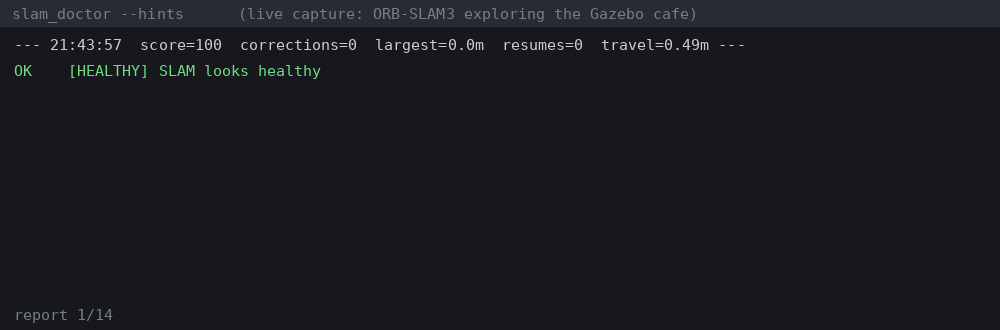

# slam_doctor

**Is my SLAM healthy?** Attach to any running ROS 2 SLAM (slam_toolbox, Cartographer, RTAB-Map, ORB-SLAM3) and get loop-closure and map-correction timestamps, tracking-lost flaps, map stalls, odometry drift and feature-poor camera views.

Companion to [nav2_doctor](https://github.com/darshmenon/nav2_doctor) (why isn't my robot moving?). Built from the [rosnav](https://github.com/darshmenon/rosnav) project's mapping bugs.



```bash
ros2 run slam_doctor slam_doctor                                   # live report every 2 s
ros2 run slam_doctor slam_doctor --image /camera/image_raw --hints # + camera quality, next steps
ros2 run slam_doctor slam_doctor --once 30 --json                  # CI: exit 1 on ERROR
ros2 run slam_doctor slam_doctor --events loops.jsonl              # loop-closure timeline
```

Real output from a slam_toolbox maze run (a 0.51 m `map->odom` correction) and an ORB-SLAM3 cafe run:

```
WARN  [BIG_JUMP] map jumped 0.51m / 0.0deg 7s ago
      -> large map correction: expect plan and costmap jumps; clear costmaps after it (costmap_ghost_clear)

WARN  [FEATURE_POOR] 5 consecutive frames: 74 keypoints, sharpness 52, mean 145
      -> few corners in view (blank wall/floor): a feature-based SLAM will lose tracking here
```

## Checks

| Code | Level | Meaning |
|---|---|---|
| `TRACKING_LOST` | ERROR | `map->odom` silent for 5 s |
| `TRACKING_FLAP` | WARN | tracker stopped and resumed 3+ times in 30 s |
| `MAP_STALL` | ERROR | no new free cells for 20 s while the robot moved 1 m |
| `JUMP_STORM` / `BIG_JUMP` | WARN | 4+ map corrections in 60 s / a correction of 0.5 m or more |
| `DRIFT_HIGH` | WARN | more than 0.10 m of map correction per metre travelled |
| `FEATURE_POOR`, `BLURRED`, `DARK`, `OVEREXPOSED` | WARN | camera frames a feature-based SLAM will struggle with (`--image`) |
| `NO_MAP_ODOM`, `MAP_NONE` | WARN | no `map->odom` or no `/map` seen |

A correction is a `map->odom` step over 0.10 m or 2 degrees, which is what a loop closure or scan-match jump looks like to the rest of the stack. `--events` writes each one with its time, distance and angle. `--diagnostics` also publishes `/diagnostics`, and the report carries a 0-100 health score.

## How it works

Only topics: `/tf` (`map->odom`), `/odom`, `/map` and optionally a camera. No SLAM-specific plugin, so it works with any backend. Camera checks use OpenCV ORB when installed and a NumPy corner proxy otherwise, sampled at 1 Hz.

## Limits

- Loop closures are inferred from `map->odom` steps, so a SLAM that publishes corrections smoothly will show smaller steps.
- Camera thresholds were calibrated on 20 Gazebo cafe frames (ORB at `fastThreshold=7`, ORB-SLAM3's own minimum: 681-1000 keypoints everywhere; default FAST gave as few as 8). Real cameras differ, so check your own frames; the first draft used default FAST and flagged a healthy ORB-SLAM3 run in 44 of 47 reports.
- One robot per run; use `--ns` once per robot.

## Roadmap

- per-camera calibration command (`slam_doctor --calibrate DIR`)
- live terminal view, multi-robot discovery
- score a rosbag offline

Apache-2.0
